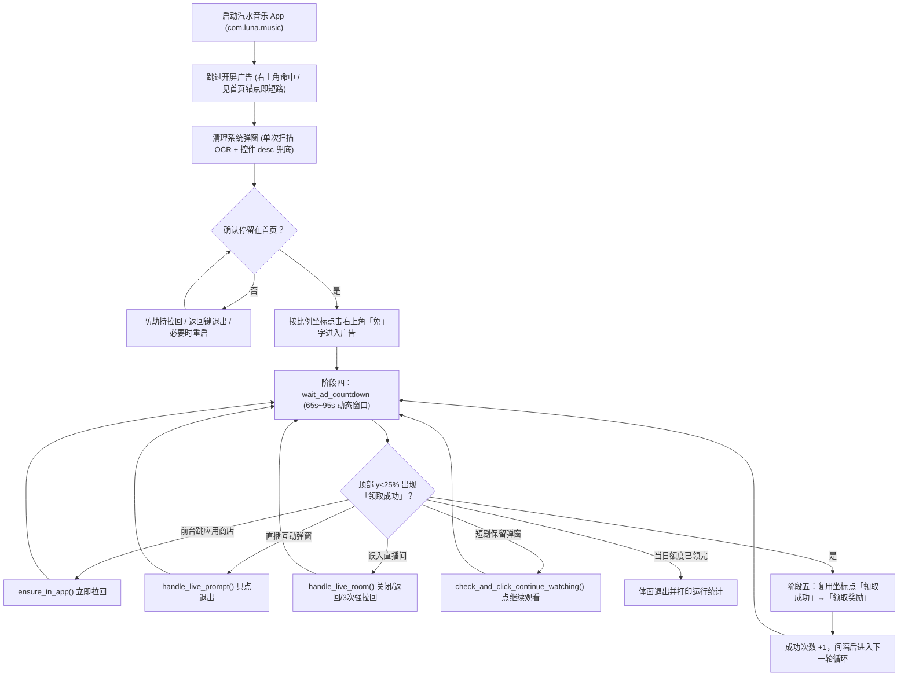

# 汽水音乐 安卓自动化脚本

[](https://github.com/wangyudawang1/qishuiAScriptProject/actions/workflows/test.yml)
[](https://github.com/wangyudawang1/qishuiAScriptProject/releases)
[](tests/test_qishui_android.py)


基于 AScript 安卓引擎的自动化脚本，自动观看汽水音乐广告以获取免费听歌时长。

> ### 📌 来源声明（原作者致谢）
>
> **本项目改造自 [@wei6718189](https://github.com/wei6718189) 的开源项目 [wei6718189/qishuiAScriptProject](https://github.com/wei6718189/qishuiAScriptProject)（iOS 版）**
>
> 原项目是 iOS 专用脚本，依赖 WebDriverAgent + `ascript.ios.*`。  
> 本项目在其基础上完成 **Android 平台完整适配**，改写为 `ascript.android.*` 引擎，并针对复杂广告生态完成了全链路稳定性加固；原 iOS 代码完整保留在 [`__init___ios_backup.py`](./__init___ios_backup.py)。
>
> 衷心感谢原作者 [@wei6718189](https://github.com/wei6718189) 的开源贡献！

---

## ⚡ 深度优化与稳定性增强说明

在适配 Android 平台基础上，对 `__init__.py` 进行了全量代码审计与工业级加固，彻底消除隐藏缺陷：

| 优化项 | 原实现隐患 | 现改进方案与收益 |
| :--- | :--- | :--- |
| **AScript `Selector` + `Rect` 修复** | 仅尝试 `.left/.top`（遗漏 AScript 原生 `Rect.x1/y1/x2/y2`），未绑定 `mode=2`，且控件查找未校 `rect` 边界 | 新增 `_parse_rect()` 兼容 `x1/y1/x2/y2` 与 `left/top/right/bottom`，绑定 `SELECTOR_MODE = 2`，强制 `_in_rect()` 校验并支持 `find_all()` |
| **弹窗清理单次扫描提速 14× + 安全返回** | `dismiss_popups()` 每轮逐词 OCR 耗时 5~11 秒；找不到关闭按钮时盲点 `y=8%` 易误触顶部搜索栏 | 改为每轮单次 `scan_screen_texts()` + 内存匹配；兜底改用 `action.Key.back()`；`ocr_find(rect=...)` 消除无谓双倍全屏 OCR |
| **多机型入口预设 & 进度弹窗/落地页兼容** | 写死右上角单坐标，华为等机型播放页右侧入口点不到；缺少「解锁第N天畅听」与会员推销落地页关闭逻辑 | 配置抽离至 [`config.py`](config.py)，内置 `default_top_right` 与 `huawei_play_side` 预设 + 自动回退探测；精准处理进度解锁弹窗与 App 内落地页 |
| **精准首页校验 & 倒计时卡死早退** | 首页全屏子串匹配易被广告文案「发现好物」误触发；视频缓冲冻结会死等满 95 秒 | 顶部/底部区域分离 + 底部标签精确匹配；同一倒计时秒数停滞 ≥ 15 秒提前结束并重启恢复（`Home` 键打断 + 可选冷重启） |
| **防机械点击微抖动 & 目标次数控制** | 固定像素坐标连点；无领满 N 次自动停止与结束提示 | 新增 `CLICK_JITTER_PX`（边界内 ±4px 微抖动）、`TARGET_CLAIM_COUNT` 与可选 `Toast` 统计汇总 |
| **工程规范、测试 CI 与手机端直装包** | 测试覆盖不足且无开箱即用手机包 | 扩充至 **36 组零真机依赖单元测试**（[`tests/test_qishui_android.py`](tests/test_qishui_android.py)）、4 矩阵 CI，并在 [Releases](https://github.com/wangyudawang1/qishuiAScriptProject/releases) 提供纯净手机端 `.zip` |

---

## 功能流程



## 运行环境

- **平台**：Android（实测 vivo V2055A / Android 14 / 1080×2400）
- **AScript App**：4.0.17+，运行模式「无障碍模式」
- **必需权限**：辅助功能（无障碍）、录屏授权、悬浮窗
- **OCR 引擎**：`paddle`（百度 PP-OCR V5，默认）或 `mlkit`（谷歌，更快）

## 项目结构

```text
qishuiAScriptProject/
├── __init__.py                     # 安卓版主入口与核心状态机（AScript 工程约定文件名）
├── config.py                       # 独立用户配置（预设坐标、超时、抖动、目标次数等）
├── __init___ios_backup.py          # 原 iOS 版脚本完整备份
├── tests/
│   └── test_qishui_android.py      # 36 组核心状态机与回归单元测试（纯标准库）
├── .github/
│   ├── workflows/
│   │   ├── test.yml                # GitHub Actions 4 矩阵 CI
│   │   └── release.yml             # Tag 发布自动打包纯净手机端 .zip
│   └── ISSUE_TEMPLATE/             # Bug 反馈与机型坐标分享模板
├── res/img/                        # 工程图标与模板图
├── .vscode/
│   ├── settings.json               # 平台 / 设备地址 / Python 路径
│   └── .syncignore                 # 手机端同步排除规则（自动排除 tests/、.github/、文档等）
├── .trae/rules/ascript.md          # AScript AI 编码规则
└── .gitattributes                  # 统一 LF 换行符策略
```

## 快速开始

> 💡 **免电脑 / 纯手机用户**：可直接前往 [Releases](https://github.com/wangyudawang1/qishuiAScriptProject/releases) 下载 `qishuiAScriptProject-v*.zip` 纯净工程包，解压导入 AScript App 即可使用。

### 1. 手机端

1. 装 AScript App，开启**无障碍**权限
2. 进 App 的「开发者」页，开启**设备服务**（默认端口 `9096`）
3. 记下手机局域网 IP，如 `192.168.1.100`

### 2. 电脑端

1. 装 VS Code + AScript 插件
2. 确认 `uvx --version` 可用
3. 把手机 IP 填进 `.vscode/settings.json` 的 `ascript.deviceId`
4. 手机和电脑连同一个 WiFi

> `.vscode/settings.json` 里的 `192.168.1.100:9096` 是占位示例，请换成你自己手机的 IP 和端口。

### 3. 运行与本地跑测试

- **运行工程**：在 VS Code 里用 AScript 插件运行工程，或让 AI 调用 `run_project`。
- **本地运行全部单元测试（零真机依赖）**：
  ```bash
  python -m py_compile config.py __init__.py tests/test_qishui_android.py
  python -m unittest discover -s tests -v
  ```

## 让它自己跑（无人值守）

脚本本身已经是全自动的（`AUTO_CLICK_MIAN = True`），启动后不用管。要彻底脱离电脑，按下面三步做。

### 第一步：手机端直接运行

1. 手机打开 **AScript App**
2. 进「**工程管理**」→ 找到 `qishuiAScriptProject`
3. 点 **运行**

工程已经上传到手机了，不需要电脑参与。运行后手机会自己点「免」字、看广告、领奖励，一直循环到当日额度用完（识别到领满提示或连续 10 轮没领到会自动退出）。

### 第二步：系统设置防中断

这几个设置不做，跑几分钟就会被系统掐掉：

| 设置项 | 路径（vivo 为例） | 作用 |
|--------|------------------|------|
| 电池优化白名单 | 设置 → 电池 → 后台耗电管理 → AScript → 允许后台高耗电 | 防止后台被杀 |
| 自启动 | 设置 → 应用管理 → AScript → 权限 → 自启动 | 允许后台存活 |
| 保持唤醒 | 开发者选项 → 不锁定屏幕（充电时） | 双保险 |

脚本内部已经调了 `Device.keep_screen_on()`，会保持屏幕常亮；每轮开始还会 `Device.wake_up()` 唤醒，所以息屏也能恢复。

### 第三步（可选）：打包成独立 APK

想更彻底、连 AScript App 都不用开：

1. AScript App → 首页找到「**打包独立程序**」
2. 选择 `qishuiAScriptProject` 工程
3. 生成 APK 并安装

打包后的 App 可以设桌面图标直接点、配合系统自启动实现开机跑。

### 定时每天跑

AScript 没有内置定时任务，用手机系统自带的能力：

- **vivo**：设置 → 快捷与辅助 → 自动任务 → 新建（定时启动指定应用）
- **第三方**：Tasker / MacroDroid 定时启动 AScript 并运行工程

## 关键配置（[`config.py`](config.py)）

所有可调参数已抽离至 [`config.py`](config.py)，升级主脚本不会覆盖你的个人配置：

| 常量 | 默认值 | 说明 |
|------|--------|------|
| `APP_PACKAGE` | `"com.luna.music"` | 安卓版汽水音乐包名 |
| `MIAN_PRESET` | `"default_top_right"` | 入口坐标预设：`"default_top_right"` `(0.937, 0.063)` 或 `"huawei_play_side"` `(0.790, 0.814)` |
| `MIAN_X_RATIO` / `MIAN_Y_RATIO` | `None` | 手动微调相对比例；设为小数时优先覆盖预设 |
| `AUTO_TRY_MIAN_FALLBACK` | `True` | 主坐标点击后若仍在首页，自动尝试备选入口坐标 |
| `AUTO_CLICK_MIAN` | `True` | 是否自动点「免」字（`False` = 半自动，由你手动点第一次） |
| `SELECTOR_MODE` | `2` | 无障碍控件检索模式（`2=FILTERED_SIMPLE`，root 设备改 `9`，HID 改 `6`） |
| `TARGET_CLAIM_COUNT` | `0` | 目标领取次数（`0` = 不限次数，领满或空跑达上限退出） |
| `FIRST_ROUND_TIMEOUT` | `70` | 首轮等待广告结束超时（秒） |
| `AD_COUNTDOWN_TIMEOUT` | `65` | 单轮广告默认等待超时（秒，覆盖 30s~60s 长广告） |
| `MAX_AD_TIMEOUT` | `95` | 动态倒计时延长上限（秒） |
| `COUNTDOWN_STALL_TIMEOUT` | `15` | 倒计时数字停滞超时（秒，超时提前结束本轮；`0` 关闭） |
| `CLICK_JITTER_PX` | `4` | 防机械点击随机微抖动半径（像素；`0` 关闭） |
| `KEEP_SCREEN_ON` | `True` | 屏幕常亮，防息屏中断 |
| `AUTO_RESTART_APP` | `True` | 连续失败达到 3 的倍数轮次时自动重启 App 恢复 |
| `ENABLE_COLD_RESTART_FALLBACK` | `False` | 重启恢复时是否通过 shell 执行 `am force-stop`（Root/Shizuku 适用） |
| `OCR_ENGINE` | `"paddle"` | OCR 引擎（仅支持 `"paddle"` / `"mlkit"`） |
| `LOOP_INTERVAL` | `3` | 每轮间隔秒数 |
| `MAX_LOOP_COUNT` | `100` | 最大循环次数（约 40 分钟） |
| `MAX_IDLE_ROUNDS` | `10` | 连续空跑退出阈值（若识别到今日领完文案则立即提前退出） |

### 已实测机型坐标预设表

| 预设名 / 机型 | 分辨率 | 入口位置 | 比例坐标 `(X, Y)` | 贡献者 |
| :--- | :--- | :--- | :--- | :--- |
| `default_top_right`（vivo V2055A 等） | `1080×2400` | 首页右上角「免」字 | `(0.937, 0.063)` | [@wangyudawang1](https://github.com/wangyudawang1) |
| `huawei_play_side`（华为 Mate40 Pro 鸿蒙） | `1152×2376` | 播放页点赞行右侧 | `(0.790, 0.814)` | [@mengsen182](https://github.com/mengsen182) (Issue #1) |

> 欢迎通过 [Device Profile 模板](.github/ISSUE_TEMPLATE/device_profile.yml) 提交更多机型的实测比例！

## 与 iOS 版的主要差异

| 项目 | iOS 版 | 安卓版 |
|------|--------|--------|
| 模块前缀 | `ascript.ios.*` | `ascript.android.*` |
| 启动 App | `app_start(bundle_id=)` | `system.open(package)` |
| 包名 | `com.soda.music` | `com.luna.music` |
| 控件树 | WDA dump 不稳，走 OCR | 无障碍控件树，`Selector(mode=2)` 15ms 级 + `Rect(x1,y1,x2,y2)` |
| 「免」字定位 | OCR | **比例坐标**（该按钮是图片，无 text 属性，前置校验首页后再点） |
| 点击通道 | WDA（易被检测） | 无障碍通道（不被检测） |
| 屏幕尺寸 | `screen_size()` | `Device.display()` |

## 已知要点与坑点防御

1. **「免」字是图片按钮**：控件树里没有它，OCR 也识别不出。代码在 `main()` 与失败恢复分支均**先确认已停在首页**，再按比例坐标点击，绝不盲目点击。
2. **倒计时文案**：位于顶部区域（`y < 18%`），代码使用 `r"(\d+)\s*秒后"` 完整解析两位数秒数并动态顺延超时。
3. **底部假文案屏蔽**：「领取成功」严格限定在顶部栏（`y < 25%`），防止广告正文内的营销文案误触发阶段五。
4. **广告底部有「立即下载」大按钮**：「继续观看」严格限定在屏幕中段（`y: 25%~68%`），绝不误触底部下载跳转。
5. **不要写 `if __name__ == "__main__"`**：AScript 工程入口约定不同，主体代码直接写在顶层；测试时通过环境变量 `QISHUI_TEST_MODE=1` 安全隔离入口。

## 广告中途的两种挽留弹窗（重点）

广告播放到一半会弹窗，**两种弹窗的正确操作完全相反**，点错就拿不到奖励：

### ① 短剧/视频广告的挽留弹窗 → 点「继续观看」

```text
再看05秒继续解锁
   第24日免费听
┌─────────────────┐
│    继续观看      │  ← 绿色主按钮，点这个
└─────────────────┘
     坚持退出         ← 灰色小字，绝不能点（放弃奖励）
```

实测坐标：`继续观看` @ `(538, 1282)` @ 1080×2400。代码已通过 `_is_short_drama_retention()` 专门保护该弹窗不被当作直播拦截，同时在退出过滤列表屏蔽了 `"坚持"` / `"放弃"` 字样。

### ② 直播形式广告的互动弹窗 → 点「退出」

```text
继续互动还是退出？
5 秒后自动进入直播间
```

- 点「继续互动」→ 进直播间，**直播间不算广告时长**，白看
- 点「退出」→ 留在广告页，正常拿奖励

代码里的 `_is_live_prompt()` 与 `handle_live_prompt()` 会拦截该弹窗，只点 `退出互动 / 退出直播间 / 不感兴趣 / 退出 / 取消 / 关闭`，**绝不点含「继续 / 进入 / 坚持 / 放弃」的按钮**。

### ③ 已经误入直播间 → 立即退出

`handle_live_room()` 会检测 `更多直播 / 说点什么 / 在线观众 / 直播间人数` 等特征，按顺序尝试：无障碍 `desc("关闭"/"退出")` → 顶部文字/`×`/`✕`/`✖` → 右上角 `X` → 返回键兜底；若连续 3 次退出失败卡死，直接 `system.open("com.luna.music")` 强制拉回。

### 性能设计

直播互动弹窗只有 **5 秒**反应窗口，因此阶段四与弹窗清理每轮**只做一次全屏 OCR**（`scan_screen_texts()`），在内存里按优先级匹配所有条件，彻底消除重复截屏识别延迟。

> ⚠️ `Ocr.find()` 与 `Ocr.find_all()` 在不同引擎下可能返回 **`dict`** 或 **`OcrText` 对象**，项目已通过 `_extract_ocr_item()` 统一适配。

## 免责说明

脚本仅用于自动化观看广告领取官方免费权益，请遵守汽水音乐用户协议。每日有领取上限，检测到额度用完提示或连续 10 轮空跑会自动退出。

## 致谢

- 原项目：[wei6718189/qishuiAScriptProject](https://github.com/wei6718189/qishuiAScriptProject)（原作者 [@wei6718189](https://github.com/wei6718189)）
- 自动化框架：[AScript](https://www.ascript.cn)（Python 移动端自动化引擎）
